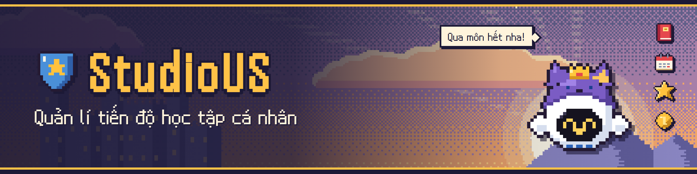

<p align="center">
  
</p>

# StudioUS – Personal Study Progress Manager

A study progress tracker for **Software Engineering students at HCMUS (University of Science, VNU-HCM), 2025 intake**. It manages the curriculum, academic results and progress toward graduation, stores data on the device with LocalStorage and works without an Internet connection.

**Status:** **StudioUS – Study Progress Manager** (Vite + React + TypeScript + plain CSS, decided on 11/11/2026) for **K26** students, based on the **2025-intake Software Engineering curriculum**. Four pixel-art screens (Dashboard, Courses & Grades, Timetable & Exams, Data), a color button with 5 themes, and a mascot whose outfit changes with the theme. The course catalog is fully transcribed from the curriculum (section 7, study plan in section 8, Appendix 1); grading rules follow the updated requirements analysis report (22/11/2026: A+ ≥ 9.0 … C ≥ 5.0, D+ ≥ 4.0, D ≥ 3.0, F < 3.0 with 4-point equivalents; pass ≥ 5.0; cumulative GPA on the 10-point scale over passed courses only).

## Getting started

Tooling checked with Node.js `24.13.0`, npm `11.12.1` and Git. Node/npm are only used for development tools; Docker is not required.

```powershell
git clone https://github.com/pgtomvn/StudioUS.git
cd StudioUS
npm ci
npm run doctor
npm run check
```

- `npm run dev`: run the app in development mode at `http://localhost:5173`.
- `npm run build`: type-check, then bundle everything into **a single file** `dist/index.html` (JS, CSS, fonts and pixel images are all inlined; no CDN or API calls).
- `npm run preview`: serve the build at `http://localhost:4173`.
- `npm run test`: run the unit tests (Vitest) for the LocalStorage layer and progress aggregation.
- `npm run assets`: regenerate all pixel images (backgrounds, mascot, icons) into `src/assets/pixel/`.
- `npm run sfx -- "<folder of the extracted CC0 sound pack>"`: regenerate the sound effects into `src/assets/sfx/` (see Sound). Without a folder, only the self-made sounds are regenerated.
- `npm run doctor`: check Node/npm, Git and the folder structure.
- `npm run format`: format tooling files and documents with Prettier.
- `npm run format:check`: check formatting.
- `npm run progress -- --help`: how to log progress with Vietnam time.

`npm run check` runs doctor, the format check, the type check and the unit tests. The first install (`npm ci`) needs a network connection; after that, running, building and using the app do not.

### Offline use

After `npm run build`, open `dist/index.html` in a browser (the file can be copied to another machine), or run `npm run preview`. Data is stored in the browser's LocalStorage per origin: opening via `file://` and via `localhost` gives two separate data stores, so stick to one way and use backup/restore on the Data screen when switching or moving to another machine.

### Color themes and pixel art

The **Đổi màu** (Change color) button (sidebar on desktop, top bar on mobile) opens a picker with 5 themes: Sunset, Meadow, Arcade, Starry Night and Campus. Each theme changes the palette, background image and mascot outfit; the choice is saved in LocalStorage. All images are drawn in code by `scripts/generate-pixel-assets.mjs` (nothing is downloaded): 5 backgrounds, 5 mascot sets (2 frames) and 15 icons.

## Project structure

```text
AGENTS.md                 Coordination and hand-off rules for agents
PROGRESS.md               Task board and step-by-step log
docs/
  architecture.md         Architecture constraints and decisions
  project-scope.md        Scope and parts not yet implemented
  data-sources.md         Curriculum sources and verification status
  requirements/           Requirement traceability
  design/                 Design notes
  testing/                Test plan and actual results
  ai/                     Prompts, adjustment log, AI usage evidence
  planning/               Work plan
  meetings/               Meeting notes
  references/             Verified references
  assets/                 README banner (HTML source and PNG)
index.html, vite.config.ts, tsconfig.json   Entry point and Vite/TypeScript config
src/
  app/                    App shell: sidebar, bottom tabs, hash routing, theme picker
  components/ui.tsx       Pixel frames, buttons, progress bars, dialogs, toasts, HUD, mascot
  components/Pet.tsx      Interactive mascot; SoundPanel.tsx: sound button and settings panel
  styles/                 themes.css (fonts + 5 palettes), app.css (layout, components, mobile)
  domain/                 rules.ts (grading scale, language requirement), progress.ts (progress, credit roll-up)
  data/                   curriculum.ts (Software Engineering 2025 curriculum), sample.demo.ts (two sample datasets, see below)
  features/               dashboard, curriculum, schedule, data-management (academic-records still empty)
  lib/                    store.ts (state + autosave), time.ts, files.ts, mascot.ts,
                          sound.ts (effects player), music.ts (self-composed 8-bit background music)
  lib/storage/            LocalStorage read/write, data versioning, import file validation
  types/                  App data types
  assets/                 fonts/ (Galmuri9, Handjet, VT323 – OFL), pixel/ (script-generated images), sfx/ (8-bit WAV)
public/                   data, icons; no official course data yet
tests/                    unit (curriculum, progress, rules, study weeks, storage, mascot, sound); integration, e2e still empty
scripts/                  Environment check, progress logging, pixel image and sound effect generators
```

The sources of the course catalog and grading rules are noted at the top of `src/data/curriculum.ts` and `src/domain/rules.ts`; see also [data sources](docs/data-sources.md). Real academic records are never committed to Git.

## Main features

- **Courses & Grades (Học phần & Điểm):** courses are grouped exactly by curriculum section (7.1.1 … 7.2.4). Required courses are always counted; elective courses must be ticked with **Chọn** (Select) (the free-elective group is picked via "+ Chọn học phần" with search). Each row is filled in the order **Semester → Status → Grade**; a semester later than the current one shows a warning with an update button.
- **Physical education:** a collapsible block like the other course groups (arrow, group name, "x / 4 TC" label, progress bar), placed after the Graduation block and above Additional requirements. It contains Physical Education 1 (BAA00021) and Physical Education 2 (BAA00022), entered as Semester → Status → Grade like other courses but not counted toward the 138 credits or GPA; there is an **Exempt** (Miễn) button. The physical education requirement is derived automatically: both courses passed (Completed, grade ≥ 5.0) → Passed; Exempt → Exempt; in progress / not taken / no grade → Not yet. These courses can also be chosen when adding classes and exams.
- **StudioUS logo** (sidebar and mobile top bar) returns to the Dashboard.
- **Info bar** (avatar, name, credits, GPA) on the Courses, Timetable & Exams and Data screens stays in place while scrolling (desktop: 24 px from the top; mobile: right below the top bar).
- **Typography:** body text uses the Galmuri9 pixel font (full Vietnamese diacritics), headings use Handjet; screens narrower than 768 px get extra line and letter spacing.
- **Timetable & Exams (TKB & Thi):** choose Semester 1 … current semester or **All** (Semester 1 to the current one). Weeks always start at Week 1 from the semester start date. Each class is **Theory** or **Practice** (a course can have both); the session type is shown on a line under the course name on the timetable, together with time and room.
- **Data (Dữ liệu):** profile and **semester information** (start and end dates) must be filled in from Semester 1 to the current one; back up/restore a `.json` file, reset data.
- **Feedback round (22/11/2026):** course cards (≤ 1365 px) show labelled fields (Semester, Status, Grade, Result) and a clear result (letter · 4-point · Pass); curriculum section 3 is “Toán – Khoa học tự nhiên – Công nghệ – Môi trường” (36 credits) with parts 3.1–3.4; the out-of-semester warning has a second button that jumps to the course; Quests list and dialogs show a pixel scrollbar; the profile card shows the faction (“Môn phái: Kỹ thuật phần mềm”) and % completion; the profile form shows the major (Student ID input removed on 22/11/2026); overlapping classes are laid out side by side; class colors are red, orange, yellow, green, blue, pink, purple plus a free color picker / hex code; the backup file is named `student_k26_YYYY-MM-DD.json` (export date).
- **Two sample datasets** (Dashboard for new users, or the Data screen; both can be undone): **in progress (HK2)** – a made-up student covering every feature (all 8 letter bands with three failed courses, all statuses, a course set to HK3, all four blocks, complete/short/picker elective groups, graduation option 3, PE 1 passed + PE 2 in progress, defense passed, TOEIC short on Speaking–Writing, theory + practice of one course, overlapping classes, a custom dark color, a PE class, HK3 class/exam shown by weekday, upcoming/far/past exams); **completed (HK8)** – every course passed, one extra free elective so accumulated credits exceed 138 (bar full and green, 0 remaining), PE, defense and IELTS passed, thesis option, all graduation checks met. `tests/unit/sample.test.ts` checks both, including the GPA formula.
- **Undo instead of confirmation:** clearing a grade, removing a course's semester, unticking an elective, changing the graduation option, deleting a class or an exam happen immediately and show a notification with an **Undo** (Hoàn tác) button for 10 seconds (a bar counts down). Undo only restores what was just removed and keeps other edits made in the meantime. Resetting all data still asks you to type RESET, then also offers Undo; loading the sample data and restoring from a file can be undone the same way.

## Mascot

The pixel mascot (based on the fit@hcmus plush toy) has 7 facial expressions and changes its outfit with the color theme. On desktop it sits in the sidebar; on mobile it floats in the top-right corner above the tab bar.

- **Click:** says a line based on your progress (upcoming exams, missing credits, semester info…). Clicking 6 times in a row makes it dizzy. **Double-click:** it dances.
- **Pat its head:** hover over its head (mobile: press and hold) → heart eyes and floating hearts; affection points are saved in the browser, and leveling from Lv.1 → Lv.7 unlocks more lines.
- **Dozes off** after 45 seconds without interaction; a tap, key press or mouse move wakes it up.
- **Reactions:** passing a course (jump, falling coins), failing a course (sad, tears), changing color (spin, sparkle), ticking an elective, adding an exam, choosing a graduation option, restoring/resetting data, meeting all graduation requirements (jump, confetti). The mascot in the avatar frame and the HUD react at the same time.
- **Greetings** by time of day when the app opens, plus a few secret codes typed outside input fields (see `src/lib/mascot.ts`).

## Sound

The **Âm thanh** (Sound) button (sidebar, below the color button; on mobile the speaker button in the top bar) opens the settings panel:

- **Toggle all sound**, **Master volume** and **Effects** sliders, a switch for **button/tick/page/mascot-touch sounds** (when off, clicking, double-clicking and patting the mascot are silent too), an **8-bit background music** switch and **Music volume**. Settings are saved in `studious:settings` (key `sound`). Defaults: effects on, music off.
- **Effects:** button clicks, ticking courses, page changes, opening/closing dialogs, notifications, passing a course (coin), grade A and affection level-up (level up), failing a course, changing color (sparkle), adding an exam, meeting all graduation requirements (a fanfare of about 2 seconds), mascot talking, patting, dancing, snoring.
- **Background music:** one self-composed 8-bit track per color theme (Chiều tím, Đồng cỏ xanh, Neon arcade, Ru khúc đêm sao, Giờ ra chơi), played with Web Audio; changing the theme switches the track immediately, and it pauses when you switch to another tab. While music plays, the Sound button shows bouncing bars and the mascot bobs to the beat.
- **Sound sources:** 19 sounds from "512 Sound Effects (8-bit style)" by Juhani Junkala (SubspaceAudio, [OpenGameArt](https://opengameart.org/content/512-sound-effects-8-bit-style), CC0 license) and 5 self-made sounds from `scripts/generate-sfx.mjs` (mascot voice, patting, dancing, snoring, graduation fanfare); all stored as 8-bit WAV at 22,050 Hz (~219 KB) and embedded in the build, no network needed. Browsers only allow sound after the first click or key press.
